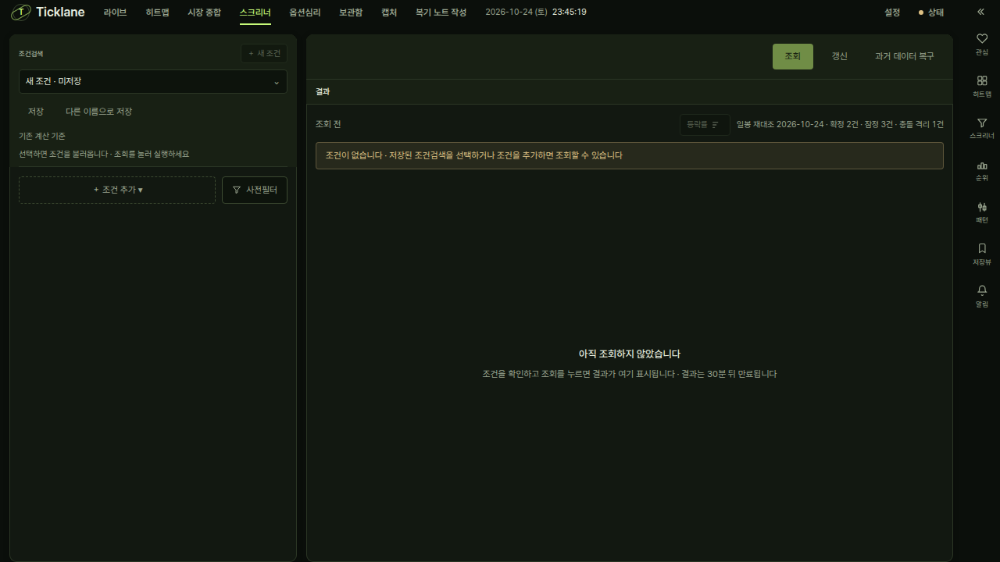

# 스크리너 갱신 경로 통합과 과거 데이터 복구 분리

2026-10-24 KST. 기존 데이터와 SavedScreener를 보존하면서, 일반 갱신 버튼을 자동 갱신과 같은
일봉 검증 경로로 연결했다. 기존 깊은 과거 누락 보충 기능은 별도 버튼·HTTP 진입점으로 옮겼다.

## 사용자 동작과 저장 기준

| 동작 | 진입점 | 처리 |
|---|---|---|
| 갱신 | `POST /api/screener/update` | 자동 갱신과 같은 최근 5거래일·기존 갭 범위 수신, 기존 값 대조, 잠정·확정·충돌 원장 |
| 밤 22시 정기 실행 | `trigger_update` | 일반 갱신 버튼과 같은 계획·수집 함수 |
| 과거 데이터 복구 | `POST /api/screener/repair-history` | 기존 종목 목록 갱신, 깊은 과거 누락 조사, 원주가/수정주가 대조, 기존 기준에 따른 추가 저장 |

일반 갱신은 과거 복구를 암묵적으로 요청하지 않는다. 최근 일봉 수집의 종료 종목 제외,
동시 조회 3개·조회당 2페이지·30분 간격·하루 2회, 체크포인트 재사용은 유지한다.
장중 16시 이전 오늘 봉은 기존 컷오프에 따라 범위에서 제외한다. 수신 시각과 다음 날짜 독립
관측이 확정의 근거이므로 버튼 연타로 당일 값을 확정하거나 기존 충돌을 해제하지 않는다.

낮에는 한 번만 시도해 하루 2회 중 밤 22시 이후 관측의 예산을 남긴다. 새 HTTP skip reason
`finalization_wait`·`retry_wait`·`daily_limit`을 BE Literal·FE union·표시 문구에 함께 반영했다.
밤 확인 대기·30분 간격 대기·한도 소진을 ‘이미 최신’으로 표시하지 않는다. 네트워크를 다시
시도하기 위해 기존 원장 시도 횟수·날짜·관측 시각을 초기화하지 않는다.

원주가·수정주가·계수·수량 이력·검색 정책·저장 조건·승인 정정 선택의 계산·추가 저장 기준은
변경하지 않았다. 별도 과거 복구도 기존 `run_refresh`와 검증 저장 함수를 그대로 사용한다.

## 중복 실행과 화면 복원

- 서버 프로세스 내 사전 계획과 작업 생성을 같은 admission lock으로 직렬화했다. 계획의
  비동기 디스크 조회 중 겹친 요청이 오래된 계획으로 새 작업을 생성하지 않게 한다.
- 버튼·스케줄러 동시 요청 20건이 계획 1회·수집 1회로 합쳐지는 것을 이벤트 게이트로 검증했다.
  일반 갱신 요청은 깊은 복구 플래그를 설정하지 않는다.
- 명시적 과거 복구가 일반 갱신 도중 요청되면 현재 작업 뒤에 한 번 이어 실행한다. 복구 중
  재요청도 별도 동시 복구를 만들지 않는다. HTTP 연결 취소는 시작한 서버 소유 작업을 취소하지 않는다.
- 두 버튼은 같은 mutation·서버 진행 상태를 사용한다. 진행 중 둘 다 비활성화하고 재진입·새로고침은
  기존 REST/WS 상태에서 복원한다. 추가 polling은 만들지 않았다.
- 과거 `last_refresh` 기록은 보존한다. 더 새 일봉 재대조가 있으면 옛 과거 복구의 실패 결과를
  최신 일반 갱신의 실패로 되살리지 않는다. 페이지와 우측 스크리너에 같은 규칙을 적용한다.

## 비교와 검증

`verification-inputs.json`에 head/base SHA, 소스·테스트·픽스처·lockfile·설정 해시와 도구 버전을
고정한다. 백엔드 입력은 main 추가 전후 동일해 전체 통과 결과를 재사용했다(`backend-reuse-audit.json`). 최신 main `e3248951f5d31eadee673df468fb8b0e2cd2618a`을 포함한 작업이다.

- `legacy-comparison.json`: 원래 보존한 7개 저장 검색을 같은 시각·조건으로 실행해 결과가 동일함을 확인했다.
- `http-before.json.gz`·`http-after.json.gz`: 실제 운영 v2 원수량 신고거래량·주식 수 조정 신고거래량·
  가격 조건 3개를 반영 전후 비교해 모두 동일했다. 새 실행의 현재 코드 지문과 정확 재실행, 옛 실행의 GET 보존도 확인한다.
- `operation.json`: 운영에서 일반 갱신 POST 3건이 완료된 데이터에 대해 no-op이고 과거 복구를
  시작하지 않는지 확인한다. 원장 파일·보호 대상 8파일과 미존재 3경로·복구 작업 9파일·v2 스냅샷·
  기존 공급자 응답이 그대로인지 확인한다. 운영의 깊은 과거 복구는 실행하지 않는다.
- 실제 공급자 호출 없이 HTTP/파이프라인 검증, 명시적 과거 복구의 기존 보충 결과,
  스케줄러 합류·요청 취소 격리·종결 상태 정리·재시도 대기·밤 예산 보존을 회귀 검사한다.
- `e2e.txt`: 격리된 무자격 서버·시스템 Chrome·워커 1개로 일반 검증과 과거 복구의 별도 요청,
  동시 비활성화, 진행 복원, 완료 결과 복원, 옛 실패 메시지 제거를 검사한다. 두 시나리오 모두 통과했다.
- 프론트 전체 검사 중 차트의 reveal 타이밍 검사 1건과 지표 성능 검사 1건이 실패했다.
  해당 두 파일을 재검증해 181개 검사가 통과했다. 입력을 바꾸거나 시간 제한을 늘리지 않았다.
  전체 실행에서 통과한 9,016개와 해당 파일 재검증 결과를 구분해 보존한다.

운영 반영은 검증한 13개 파일만 백업 후 기존 uvicorn reload와 Vite HMR으로 활성화했다.
사용자 서버의 수동 종료·재시작, 자격증명 복사, 데이터·저장 조건 이관은 하지 않는다.
운영 상태와 최종 테스트 수는 `operation.json`·`validation.json`에 기록한다.
`python verify_artifacts.py`는 보고서 파일의 해시를 읽기만 한다.

최종 검증: 백엔드 7,122개 통과(2건 건너뜀·13건 제외), 집중 회귀 103개 통과, 브라우저 2개 통과, TypeScript·Ruff·빌드 통과. 최신 main 포함 프론트 전체 9,024개가 통과했다. 초기 전체 검사에서 실패했던 두 파일은 별도 181개 재검증도 통과했다. 운영의 원장·기존 원본 응답·데이터·저장 조건·v2 스냅샷은 모두 보존됐다.
