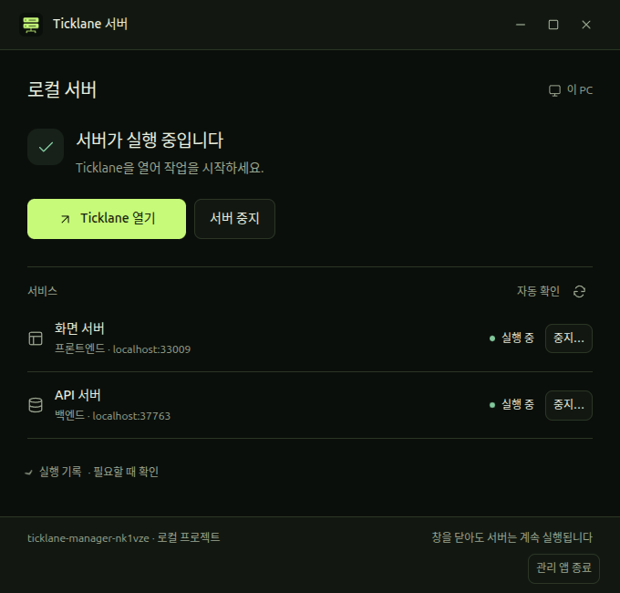
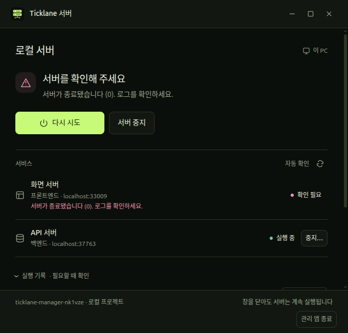

# Trading Desk desktop icons and server UI

2026-10-29 KST. Validation details, code/base commits, environment and input
fingerprints are in [validation.json](validation.json).

## Result

- Client icon retains three diagonal price ticks in lime on olive black. The
  ImageGen raster approximates the target palette; the original amber proposal
  remains in `desktop/assets/proposals/2026-10-16/`.
- Server SVG and its 1024px PNG export use `#0b0f0b` and `#c7fa79`. Both app PNGs
  are square, at least 1024px, RGBA and have transparent exterior corners.
- Installer icon basenames advance to `ticklane-local-v2.png` and
  `ticklane-server-v3.png` to refresh desktop shell caches.
- Server management UI uses the existing Trading Desk surface, text, accent and
  status colors. Running is green, transitional status is warning amber and
  failure is pink. Existing layout, window controls and stop confirmations remain.

## Verification

- Desktop typecheck, lint and build passed; all 19 unit tests passed.
- Three targeted Electron E2E tests passed, using one worker, isolated temporary
  fixture servers and separate manager/client profiles. Coverage includes automatic
  startup, stop/restart, client coexistence, 420px and 680px windows, failure/retry,
  and renderer reload preserving managed process identities.
- Visual review of the running and error captures found no overlapping labels or
  clipped controls. Long error/log content scrolls within the main region while
  the footer stays visible.
- The UI reload test now locates the accent declaration without depending on the
  previous amber hex value.
- The installed, AppArmor-approved Electron executable ran this worktree's code
  through `ELECTRON_OVERRIDE_DIST_PATH`. Chromium sandbox remained enabled; no
  AppArmor policy or launcher path was changed.
- User-facing application entries point to the new icon files, pass
  `desktop-file-validate`, and icon/desktop caches refreshed successfully.

The actual running user's management window was not directly inspected:
`orca-ide skills get computer-use` returned `command not found`. Screenshots below
are from the isolated Electron E2E instance. User services were not restarted.

## Scope

No frontend runtime, backend, dependency or lockfile changes. Frontend/backend
suites were not rerun for this desktop asset/CSS change. The validation record
binds results to the desktop source, tests, assets, lockfile and configuration;
the later documentation-only commit does not change those inputs.
