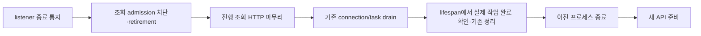

# Reload 시작 시 조회 중단과 실제 작업 종료 확인

상태: 2026-11-02 구현. `hoga serve`와 데스크톱·VSCode 개발 실행기에 적용한다.
기존 실행 중인 uvicorn supervisor에는 한 번 새 실행 명령으로 재기동한 뒤 적용된다.
이 작업에서는 사용자 서버를 재시작하지 않았다.

## 문제와 확인한 사실

2026-11-02 12:47 KST의 기존 운영 로그 한 건에서 파일 변경 감지부터 API startup까지
58.9초가 걸렸다. 기존 연결 종료 대기는 40.7초, lifespan 정리는 13.2초,
프로세스 교체와 startup은 3.7초였다. 마지막에 끝난 스크리너 감시 결과 요청은
전체 94초였으며, 이는 reload 이후 대기 시간과 다르다.
[관측 원문과 범위](../diagnostics/2026-11-02-reload-cancellation/observed-reload.json).

설치된 Uvicorn 0.47.0은 listener와 connection에 종료를 통지하고,
진행 HTTP 응답·ASGI task를 기다린 뒤 lifespan을 종료한다. 변경 전 스크리너의
`ContinuousMonitors.close()`와 `ReadRequestCoalescer.aclose()`는 router lifespan에서만
호출됐다. 이 위치에서 조회를 취소하면 앞선 연결 대기를 줄일 수 없다.

다만 HTTP 취소가 실제 계산의 종료를 뜻하지 않는다. `asyncio.to_thread`의 동기 작업과
이미 제출된 `ComputeExecutor` 작업은 별도의 완료 확인이 필요하다. 공용 wide 풀에는
조회 외에 capture parse와 depth 저장 작업도 들어간다. 풀 전체를 중단하면 조회만
취소한다는 계약을 지킬 수 없다.

이번 시험은 실제 WatchFiles 파일 변경, Uvicorn supervisor, 실제 `ContinuousMonitors`
공유 결과 소유권, `ComputeExecutor`, `_finish_disk_write`를 사용했다. 작업 부하는
2초짜리 합성 지연이다. 운영 데이터의 전체 성능 시험이나 운영 서버 개선 실측은 아니다.
[재현 방법·결과·한계](../diagnostics/2026-11-02-reload-cancellation/README.md).

## 목표와 범위

- 종료 시작 시 등록된 조회의 admission을 닫고 HTTP 독자를 신속히 반환한다.
- 실제 thread/process 작업의 종료를 확인한 뒤 그 작업이 사용하는 자원을 닫는다.
- 주문·캡처·영속 publication·체크포인트·writer lock의 기존 소유권을 보존한다.
- HTTP 종료, 실제 작업 종료, lifespan 정리, 새 API 준비 시간을 따로 기록한다.

첫 적용 범위는 `/api/screener/scan`, `/api/screener/pattern-search`,
`/api/screener/monitors/{id}/result`의 명시적 조회 소유자다. 모든 GET, 모든 refresh,
전체 asyncio task를 일괄 취소하지 않는다. 종목목록 갱신·이력 수집처럼 저장을 수행하는
작업은 이름에 조회나 refresh가 있어도 기존 영속 작업 소유자에 남긴다.

중단할 수 없는 단일 native query나 실행 중 process 작업이 있으면 전체 reload는
그 작업을 계속 기다릴 수 있다. 이번 설계는 모든 상황의 종료 시간을 상한으로 보장하지
않는다. 운영 로그의 lifespan 13.2초는 하위 계측 전까지 원인을 특정하지 않는다.

## 호출자가 사용하는 형태

아래 코드는 조립 경계를 보여 준다. 실제 구현은 `hoga/server.py`와
`hoga/api/read_shutdown.py`에 있다.

### 서버 실행기

공식 개발 실행은 `hoga serve --reload --reload-dir hoga` 한 경로로 모은다.
기존 `hoga serve`의 reload=False 기본은 유지한다. `hoga/server.py`가 단일 API
프로세스와 Uvicorn Config/ChangeReload·spawn·상속 소켓 처리를 소유한다.
supervisor에서 앱 factory나 vendor client를 미리 생성하지 않는다.

```python
class ReadDrainServer(uvicorn.Server):
    async def _wait_tasks_to_complete(self) -> None:
        try:
            reads = self.lifespan.state[STATE_KEY]
            if not isinstance(reads, ReadShutdown):
                raise TypeError("invalid read shutdown boundary")
            reads.begin()
        except Exception:
            log.exception("reload.read_retirement_unavailable; ordinary drain continues")
        await super()._wait_tasks_to_complete()
```

이 hook은 listener/connection 종료 통지 이후, connection/task drain loop 이전이다.
`shutdown()` 본문을 복사하거나 signal handler를 교체하지 않는다. 위 스케치에서
state 조회·검증도 fallback 범위 안에 있다. state 누락, 초기화 실패, 등록 owner 오류는
명시적인 진단 실패로 남기고 표준 drain과 lifespan을 계속한다. 빠른 종료 성공으로
집계하지 않는다.

지원 버전은 재현한 Uvicorn **0.47.0**으로 의존성 선언과 lock에 고정한다.
다른 버전에서는 조기 중단 기능을 비활성화하고 경고한 뒤 표준 종료를
사용한다. 지원 버전 확대는 아래 실제 reload 계약 시험을 통과한 변경으로만 수행한다.
private hook과 ChangeReload 결합은 `hoga/server.py` 안에 한정한다.

### 앱과 router 조립

```python
# hoga/api/app.py: create_app
reads = ReadShutdown()
app.include_router(build_screener_router(..., read_shutdown=reads))

# root lifespan의 기존 yield
yield {"hoga_read_shutdown": reads}

# root finally의 첫 dependency teardown 이전
report = await reads.wait_finished()
report.log_failures()  # 오류를 남기되 아래 protected cleanup을 건너뛰지 않음
# 기존 symbols/order/compute/history/collector teardown 순서는 유지
```

```python
# hoga/api/screener.py: build_router
scan_requests = ReadRequestCoalescer[ScreenerResponse]()
pattern_requests = ReadRequestCoalescer[PatternSearchResponse]()
continuous = make_owner(...)
reads.register(scan_requests)
reads.register(pattern_requests)
if continuous is not None:
    reads.register(continuous)
```

owner 등록은 해당 owner를 생성하는 조립점에 둔다. root에서 같은 목록을 다시 유지하지
않는다. ASGI lifespan state로 전달하고, middleware 안을 역탐색하거나 process 전역
앱 참조를 만들지 않는다. root/router lifespan state 병합과 teardown 순서는 실제
FastAPI 조립 시험으로 고정한다.

**root finally의 대기만으로는 충분하지 않다.** FastAPI의 중첩 router lifespan은 root보다
먼저 종료된다. `_read_requests_lifespan`의 finally 첫머리에서 완료를 기다린 뒤
observer를 해제한다.

```python
# screener.py: _read_requests_lifespan의 finally
report = await reads.wait_finished()
report.log_failures()
# 이 확인 뒤에만 release(), continuous.close(), volume_runtime.close(),
# coalescer.aclose()의 기존 최종 cleanup을 수행한다.
```

여러 router와 root의 호출은 같은 shield된 완료 task와 report를 공유한다. router의
observer/volume 의존성과 root의 client/DB 의존성을 각각 해제하기 전에 확인한다.

### 동기 조회

```python
# 하나의 shared result flight가 하나의 operation을 소유한다.
metadata = await operation.run_sync(
    lambda: _daily_contract(data_dir, manifest, codes, stop=operation)
)

# 동기 종목/페이지/배치 반복 안
for code in codes:
    stop.checkpoint()
    observation = read_observation(code)
    stop.checkpoint()
    # 로컬 결과 구성. 취소 뒤 공유 캐시에 결과를 게시하지 않는다.
```

서버가 공유 함수 자체를 영구적으로 조회 전용으로 간주하지 않는다. 같은 함수를
영속 job이 호출하면 기존 영속 실행 소유권을 사용한다. process로 threading.Event를
전달하지 않는다. process 계산에는 현재 `ComputeExecutor` 완료 계약을 그대로 쓴다.

## 타입과 책임

```python
class ReadInterrupted(Exception):
    """이 flight가 서버 종료에 의해 중단됐다는 명시적인 원인."""

class ReadOwner(Protocol):
    def begin_read_shutdown(self) -> None: ...
    async def wait_read_work(self) -> ReadDrainReport: ...

class ReadDrainReport:
    failures: tuple[Exception, ...]
    def log_failures(self) -> None: ...

class ReadShutdown:
    def register(self, owner: ReadOwner) -> None:
        """startup 조립 중에만 허용. 중복 등록과 begin 이후 등록은 오류."""
        raise NotImplementedError

    def begin(self) -> None:
        """한 loop turn에서 admission 차단·중단 원인 표시·소유 task 취소 요청."""
        raise NotImplementedError

    async def wait_finished(self) -> ReadDrainReport:
        """모든 실제 작업의 terminal ACK를 회수. 완료된 작업의 오류는 report로 반환."""
        raise NotImplementedError

class ReadOperation:
    def checkpoint(self) -> None:
        """thread-safe 취소 표시 확인. 중단이면 ReadInterrupted."""
        raise NotImplementedError

    async def run_sync[T](self, fn: Callable[[], T]) -> T:
        """실제 실행 task를 완료까지 강하게 보유. caller 취소와 분리."""
        raise NotImplementedError
```

admission·공유 flight·실제 실행 추적은 기존 owner가 소유한다. `ReadShutdown`은
owner를 연결하고 같은 종료를 한 번 시작하는 경계다. task 이름이나 URL에서 정책을
추측하는 전역 task registry는 두지 않는다.

첫 `begin()`은 각 flight의 종료 원인과 retirement event를 기록하고 token을 세운 뒤
소유 read coroutine만 한 번 취소한다. await가 없으므로 모든 owner의 admission이
같은 loop turn에서 닫힌다. 한 owner가 실패해도 나머지 owner의 중단을 모두 시도하고
오류를 보존한다. final completion은 하나의 shield된 task로 유지해 반복 호출자가
같은 완료·오류를 기다리게 한다.

완료된 작업의 예외도 terminal ACK다. owner는 한 작업의 오류로 나머지 작업의 완료
대기를 생략하지 않고 모두 회수해 `ReadDrainReport`에 넣는다. aggregate도 모든 owner를
회수한다. 이 report의 오류 때문에 protected finalizer 앞에서 예외를 던지지 않는다.
최종 정리를 끝내고 실패를 로그·종료 진단으로 보고하며, 성능 시험에서는 실패 run으로
분류한다. 실제 ACK를 얻지 못한 작업을 오류 report 하나로 대체하고 의존성을 해제하는
것은 허용하지 않는다. 아직 실행 중이면 소유권을 유지하고 기다려야 한다. 강제 종료에
따른 외부 cancellation은 정상 report로 바꾸지 않는다.

HTTP 독자는 실제 flight 완료와 retirement event를 함께 기다린다. begin 전에 실제 완료가 이미
있으면 그 성공 또는 오류를 우선한다. 해당 미완료 flight가 서버 종료로 retirement된
경우에만 `ReadInterrupted`를 503으로 변환한다. 공급자·SQL 오류, 모니터 삭제의 404,
caller disconnect와 외부 ASGI cancellation을 shutdown 503으로 덮어쓰지 않는다.
단순 `owner.closed` 검사에 따른 넓은 예외 변환은 진단 fixture에만 있고 제품에는
채택하지 않는다. wire 계약과 프론트 오류 처리는 구현 PR에서 함께 검증한다.

실제 thread future는 HTTP caller가 떠나도 owner에 남는다. callable의 정상 반환 또는
예외 회수가 실제 완료 확인이다. 함수 마지막 로그만으로 완료를 대신하지 않는다.
`wait_read_work()`가 완료 확인을 기다린 뒤에만 client/DB/cache 등 의존성을 닫는다.
cooperative checkpoint가 없는 native 호출은 끝날 때까지 기다린다. 경고용 soft
deadline을 지나면 미완료 작업 이름·단계·경과 시간을 기록하고 기다림을 계속한다.
경고 timeout이 실제 작업이나 완료 회수 task를 취소하지 않게 한다.

## 사건 순서와 보호할 작업



이 그림은 주된 흐름이다. worker나 write가 lifespan 전에 완료되는 것은 허용한다.
검사는 전체 사건을 하나의 고정 순서로 강제하지 않고 다음 선후 관계를 확인한다.

- listener 종료 통지 → read retirement → HTTP drain 완료.
- 실제 작업 완료 확인 → 그 작업의 의존성 해제.
- publication·주문 완료 확인 → 해당 소유자의 자원 정리.
- collector flush·writer lock 반환·이전 자식 종료 → 후속 소유자 시작.

`ContinuousMonitors.close()` 전체를 pre-drain으로 옮기지 않는다. 조기 단계는 result
admission/flight와 결과 전용 evaluation까지만 담당한다. coordinator와 공유하는
evaluation·preparation·volume target·trade observer·collector IPC 해제는 기존 close에
남긴다. 신규 result를 만들 수 있는 경로는 admission을 확인한다. 구현 전에 공유 task
소유권을 목록화하고, 조기 중단한 producer가 다른 경로로 다시 생성되지 않음을 검증한다.

주문 journal/dispatch, capture parse/save, 이력 publication, Today Promoter,
collector flush는 조기 조회 owner에 등록하지 않는다. shared wide 풀은 종료·terminate하지
않는다. 일반 refresh도 영속 publication을 하는지 확인한 뒤 분류한다.

## 대안 비교와 합성 결정

후보 A는 서버의 pre-drain adapter, 후보 B는 기존 Uvicorn handler에 연결하는 앱 소유
signal bridge를 독립적으로 설계했다. 두 후보는 별도의 모델 실행에서 작성했다.
교차 심사는 gpt-6-astra가 수행했다.

| 검토 기준, 각 4점 | A: 서버 adapter | B: signal bridge |
|---|---:|---:|
| listener 이후·drain 이전 및 signal 없는 종료 | 4 | 1 |
| 실제 작업 완료·영속 작업 보호 | 3 | 3 |
| 소유권·반복 호출·오류 원인 | 3 | 3 |
| 실행기·state·버전·fallback | 2 | 2 |
| 작은 인터페이스와 검증 가능성 | 3 | 2 |
| 합계 | 15 | 11 |

A를 통합 경계로 선택하고 B의 동기 `begin`, per-flight retirement event,
HTTP 반환과 실제 작업 완료의 분리를 합쳤다. A의 보수적인 result 소유권 범위를
유지했다. 심사의 state lookup fallback 누락 지적을 위 스케치에서 반영했다.
점수는 구현 완료나 최종 성능 점수가 아니라 독립 설계 후보의 비교다.

signal bridge는 Linux WatchFiles의 SIGTERM reload에 한정하면 실행기 변경이 작다.
그러나 listener 종료 이후라는 위치와 signal 없는 종료를 동일하게 처리하지 못한다.
handler 설치·복원·반복 SIGINT·신호 재발생의 전역 소유권도 앱이 맡아야 하므로
선택하지 않았다. supervisor IPC handshake는 별도 채널·세대·ACK·timeout 정책을
실행기 전체에 추가하므로 현재 범위에 비해 크다. 전역 graceful timeout 축소와 전체
task 취소는 조회·영속 작업 구분을 제공하지 않아 제외했다.

## 구현 순서와 완료 기준

1. **완료 추적부터 구현한다.** 등록할 스크리너 read 경로의 raw `to_thread`를 조사해
   tracked execution으로 옮긴다. 종료 후에도 실제 future를 유지하고 예외를 회수한다.
   이 단계 전에는 조기 중단을 켜지 않는다.
2. **조회 소유자의 중단 계약을 추가한다.** coalescer와 continuous result 각각에
   admission, per-flight 원인/event, 한 번의 취소, 중복 호출 완료 공유를 구현한다.
   종목·배치·파일 읽기·캐시 게시 경계에 checkpoint를 추가한다.
3. **실제 조립과 보존을 시험한다.** root/router lifespan state, optional continuous,
   router observer/volume 해제와 root dependency 해제 각각에 앞선 실제 작업 완료를
   검증한다. 작업 하나가 실패해도 나머지 ACK 회수와 protected finalizer가 실행되는지
   확인한다. fake gateway의 실제 주문 journal/
   dispatch, 실제 publication, shared-wide capture/save와 조회를 함께 실행한다.
4. **runner와 공식 호출점을 함께 이관한다.** CLI·README·VSCode task·desktop controller와
   `desktop/src/server/processes.ts`의 프로세스 식별을 같은 변경에 갱신한다. 기존
   uvicorn으로 실행 중인 외부 서버의 안전한 식별은 유지한다. 설치 경로를 바꾸지 않는다.
5. **단계별 계측과 실제 reload 시험으로 판정한다.** 조회 중단 요청, HTTP 응답 완료,
   실제 작업 완료, symbols/order/compute/history/promoter/collector 정리, lock 반환,
   이전 프로세스 종료, 새 `/health` 성공을 별도로 기록한다. API 준비와 증권사 WS
   재등록 완료를 다른 지표로 기록한다.

단위 시험은 Event/barrier로 순서를 고정한다. 두 독자 중 한 명 이탈, 마지막 독자 취소,
cancel 중 재진입, 완료 성공·완료 오류와 종료 경합, 외부 취소 동시 발생,
cancellation-resistant coroutine, 반복 begin/close, owner 하나의 실패를 포함한다.
종료 원인으로 실제 오류가 가려지지 않아야 한다.

thread를 Event로 잡아 둔 상태에서 HTTP는 먼저 503으로 끝나고 dependency 정리는
worker future 완료까지 멈춰 있어야 한다. cooperative 작업은 checkpoint에서 완료를
확인하고, noncooperative 작업은 release 전까지 기다려야 한다. caller 취소나 반복
종료가 실행 future를 두 번 취소하면 실패다.

통합 시험은 실제 파일 변경 reload, SIGTERM, 반복 SIGINT의 강제 종료 구분,
signal 없는 `should_exit`, startup 실패·부분 startup, state 누락·잘못된 타입,
lifespan 비활성, 지원하지 않는 Uvicorn 버전, child-only factory, 상속 소켓을 검증한다.
강제 종료는 무손실 graceful 완료 보장에 포함하지 않는다.

같은 입력에서 최소 5회 반복하고, 새 `/health`뿐 아니라 이전 PID와 자식·실제 work
future·semaphore 경고·writer lock을 확인한다. 빠른 재기동이라도 실제 작업 완료
확인이 없거나 보호할 작업이 끊기면 실패다. 전체 시간 목표는 실제 앱 통합 측정 후
정하며, 합성 2초 지연 시험의 수치를 운영 SLO로 사용하지 않는다.

## 기존 결정과의 관계

- [ADR-0169](../adr/0169-request-path-compute-worker-pools.md)의 실행 future 완료까지
  CPU slot 유지, `aclose(wait=True)`, queue/semaphore 회수를 보존한다.
- [ADR-0043](../adr/0043-incremental-promote-today.md)의 native write 완료 전 lock 유지와
  [ADR-0174](../adr/0174-dedicated-python-live-capture-process.md)의 collector flush/lock/
  이전 자식 종료 후 교체를 보존한다.
- process pool 강제 종료나 wait=False로 바꾸는 후속안은 기존 ADR과 충돌하므로 별도
  결정 변경과 증명이 필요하다. 이번 안은 이를 채택하지 않는다.

## 구현과 검증 범위

`ReadWork`가 owner 내부의 flight와 동기 작업 task를 보유한다. 각 호출은
`ReadOperation`을 명시적으로 전달한다. `run_sync()`는 `asyncio.wait()`로 실제 thread
작업을 기다려 caller 취소가 전파되지 않게 한다. Python 3.14의 `shield()`는 취소 후
발생한 내부 예외를 별도 로그로 남기므로, 예상된 `ReadInterrupted`가 오류 로그로
새지 않는 이 형태를 사용한다. aggregate 완료 task에는 기존 `shield()`를 유지한다.

일반 조회·감시 결과의 동기 실행과 공유 snapshot cache에 checkpoint를 연결했다.
미완료 flight가 retirement되면 이후 정상 반환도 503으로 처리한다. begin 전에 끝난
성공·오류는 그대로 반환하며, 외부 caller 취소·감시 삭제의 404도 유지한다.
취소된 snapshot loader를 공유하던 다른 실행은 자신의 loader로 다시 조회한다.

continuous result와 공유 evaluation은 별도의 `ReadWork`를 소유한다. 조기 begin은
result admission과 flight만 중단한다. 최종 drain은 공유 evaluation의 실제 thread
완료까지 기다린다. 분봉 준비·수정계수·공유 일중 데이터의 벤더 task, volume target,
trade observer, collector는 기존 소유자가 정리한다. 이들을 조회 token으로 중단하지 않는다.
process 계산은 기존 executor가 실행 future와 slot을 보유하고 `aclose(wait=True)`로
완료를 기다린다. 공용 wide 풀의 capture parse/save를 조기 종료하지 않는다.

`reload.shutdown_phase`는 `screener_read_work`, `read_work`, `symbols`, `orders`,
`background_tasks`, `compute`, `history_jobs`, `quotes`, `live_runtime`,
`capture_workers`, `observer`의 경과 시간과 결과를 기록한다. 기존 request timing과
Uvicorn의 프로세스·startup 로그를 함께 사용한다. collector flush와 writer lock 반환은
`live_runtime` 내부이며 별도 계측은 추가하지 않았다. API 준비는 WS 재등록 완료를
뜻하지 않는다.

자동 검증은 실제 앱 조립·router·WatchFiles·새 실행기를 임시 포트와 무자격 환경에서
사용한다. 동기 스캔 부하만 Event/파일 barrier로 대체했다. cooperative와
noncooperative 각각 5회 reload에서 조회 503, 실제 작업 종료 후 volume 해제,
동시 atomic publication 완료, 이전 PID 종료, 새 API 응답, semaphore 경고 부재를
검증한다. 같은 process slot을 공유하는 실제 capture parse와 depth save가
조회 중단 뒤에도 완료되는지 별도 시험한다. 실제 주문 `CommandJournal`·`dispatch_command`와 fake gateway의 완료 및
재기동 후 중복 전송 방지는 별도 테스트로 확인한다. 기존 compute suite가 process
slot·pool 종료와 SIGTERM·SIGINT의 semaphore 반환을 검증한다.

새 실행기의 signal 없는 `should_exit`, lifespan 비활성, state 누락·잘못된 타입,
지원 버전 fallback, CLI 기본 nonreload와 startup 실패 exit code를 검사한다.
강제 반복 SIGINT·부분 startup·실자격 collector 전체의 종료 시간은 새 통합 시험에서
검증하지 않았다. 운영 데이터의 재시작 시간 개선율은 측정하지 않았다. 위 구현은
전체 종료 시간 상한을 보장하지 않으며, 남은 native query와 process 작업을 기다린다.
