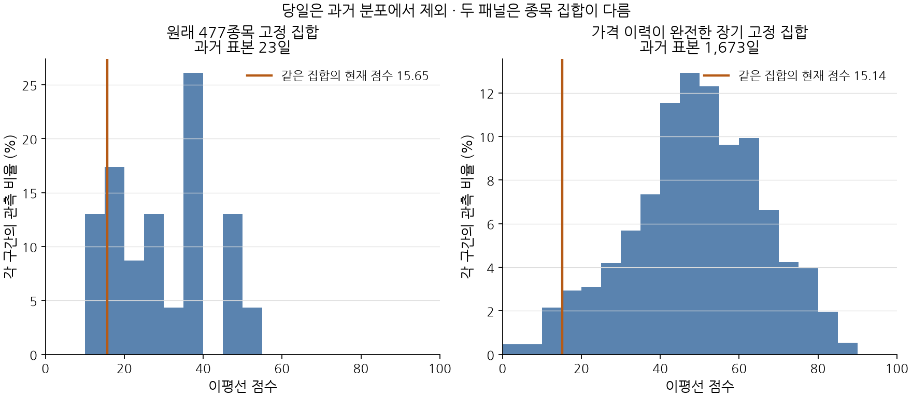
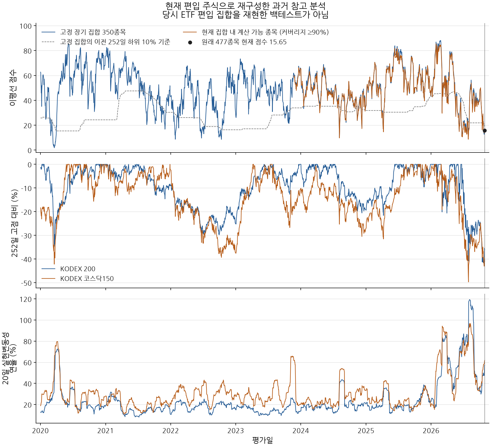

# ETF 이평선 점수의 과거 검증 — 2026-10-30

현재 낮은 점수는 **과거에도 드문 약세이며, 큰 하락·높은 변동성을 동반한다. 공포 구간으로 해석할 가격 근거가 있다.** 다만 이평선 비율 자체가 투자자의 심리를 측정하거나 공포 확률을 뜻하지는 않는다. 장기 분석에서 점수와 하락폭의 관계가 변동성과의 관계보다 강했으므로, 점수만으로 공포 등급을 확정하는 방식은 적합하지 않다.

원래 477종목 점수는 **15.65/100**으로 재현됐다. 장기 이력이 완전한 고정 350종목은 같은 계산에서 **15.14점, 2020년 이후 과거 1,673일 중 하위 3.11%**였다. 날짜별 계산 가능 종목으로 확장한 두 비교에서도 하위 2.81~2.88%였다. **350종목의 백분위를 477종목 15.65점의 확정 백분위로 붙이면 안 된다.**

## 범위와 입력

- 편입 집합: 2026-10-30 기준 38개 ETF의 주식 합집합 477종목. 참조 ETF 2개는 주식 집합에 넣지 않았다.
- 수집: 2018-01-02~2026-10-29, 거래일 2,164개. 수정 기준일 2026-10-30.
- 공급자 2회 조회 일치로 확정한 479개 대상, 가격 902,538행. 주식 898,210행과 참조 ETF 4,328행.
- 평가는 2020-01-02부터 시작한다. 2018~2019년 자료는 이평선·직전 252일 기준선 준비에 사용한다.
- 과거 분포는 2026-10-28까지이며, 평가 대상인 10월 29일은 자신의 과거 분포에서 제외한다.
- 당시 ETF 편입 집합이나 상장폐지 종목은 복원하지 않았다. 현재 생존·선택된 종목을 과거로 되돌린 참고 분석이다. 수정가격도 10월 30일 기준이므로 당시 정보 상태의 재현으로 볼 수 없다.

## 점수와 역사적 위치

종목별 `종가 > SMA20/60/120` 여부를 각각 세고, 세 비율을 동일 가중 평균한다. 같은 가격은 상회로 세지 않는다. ETF 중복 편입은 제거하고 한 종목에 한 표를 준다. 현금·편입 비중을 쓰지 않으며 원점수나 가중치를 이번 결과에 맞춰 바꾸지 않았다.

| 비교 집합 | 현재 점수 | 과거 표본 | 과거 점수보다 낮은 쪽에서의 위치 | 과거 집합의 특성 |
|---|---:|---:|---:|---|
| 원래 477종목 | 15.65 | 23일 | 표본 부족 — 장기 해석 보류 | 항상 477개, 2026-09-22부터 계산 가능 |
| 장기 고정 350종목 | 15.14 | 1,673일 | 하위 3.11% | 모든 수집 거래일의 가격이 있는 동일 350개 |
| 계산 가능 비율 ≥80% | 15.65 | 1,460일 | 하위 2.88% | 382~477개로 구성 변동 |
| 계산 가능 비율 ≥90% | 15.65 | 711일 | 하위 2.81% | 430~477개로 구성 변동 |

원래 477종목은 신규 상장 종목의 120거래일 준비 기간 때문에 당일 포함 24일, 과거 비교 23일만 가능하다. 계산상 이 짧은 표본의 위치는 13.04%지만 장기 공포 등급으로 쓰지 않는다. 최소 252개 과거 관측 기준을 충족하지 못했다.

백분위는 `100 × (더 낮은 과거 관측 수 + 동점 수/2) / 과거 관측 수`이다. 고정 350종목에서는 과거 1,673일 중 52일만 현재 15.14점보다 낮았고 동점은 없었다. 계산 가능 비율 80% 비교는 2020-11-11부터 1,460일, 90% 비교는 2023-11-23부터 711일이다. 서로 기간과 구성도 달라 세 수치의 일치는 민감도 참고 근거다.



## 같은 날의 시장 스트레스

참조 시장은 KODEX 200(069500), KODEX 코스닥150(229200)의 수정 종가다. 실제 지수·전 종목 시장과의 추적 차이는 남는다. 하락폭은 현재를 포함한 직전 252거래일 최고 종가 대비, 변동성은 일별 로그수익률 20개의 표본 표준편차에 `sqrt(252)`를 곱한 연율 값이다. 옵션의 기대변동성을 수집한 것은 아니다.

| 참조 ETF | 고점 대비 하락폭 | 하락폭의 과거 하위 위치 | 20일 실현변동성·연율 | 변동성의 과거 상위 위치 | 최근 20일 가격 변화 |
|---|---:|---:|---:|---:|---:|
| KODEX 200 | -36.11% | 0.66% | 57.14% | 6.69% | -13.99% |
| KODEX 코스닥150 | -41.04% | 0.42% | 61.72% | 7.41% | -13.11% |

과거 비교는 두 ETF 모두 2020-01-02~2026-10-28의 1,673일이다. 현재보다 하락폭이 더 깊었던 날은 각각 11일·7일이었다. 낮은 종목 점수와 큰 시장 하락, 높은 변동성이 동시에 관측되므로 현재는 단순히 이평선 아래 종목이 많다는 설명보다 강한 스트레스 근거가 있다. 다만 이를 심리의 정답 자료로 간주하지 않는다.



## 낮은 점수가 과거에도 스트레스와 연결됐나

낮은 구간은 매일 **그날 이전 252거래일 점수의 하위 10% 이하**, 높은 구간은 상위 10% 이상으로 정의했다. 당일·미래 점수를 기준선 계산에 사용하지 않는다. 동일한 고정 350종목으로 2020년 이후 1,674일을 평가한 결과다. 종목 집합 자체를 현재 정보로 골랐다는 편향은 이 절차로 제거되지 않는다.

| 참조 ETF | 점수 구간 | 날짜 수 | 하락폭 중앙값 | 실현변동성 중앙값·연율 | 최근 20일 변화 중앙값 |
|---|---|---:|---:|---:|---:|
| KODEX 200 | 낮음 | 259 | -12.77% | 21.64% | -5.14% |
| KODEX 200 | 중간 | 1,190 | -5.56% | 18.19% | 1.05% |
| KODEX 200 | 높음 | 225 | -4.25% | 18.53% | 7.66% |
| KODEX 코스닥150 | 낮음 | 259 | -21.38% | 32.35% | -8.59% |
| KODEX 코스닥150 | 중간 | 1,190 | -10.82% | 26.41% | 0.93% |
| KODEX 코스닥150 | 높음 | 225 | -9.85% | 22.23% | 8.34% |

점수가 낮은 날은 두 시장 모두 중간 구간보다 하락폭이 깊고 변동성이 높았다. 각 구간의 스트레스 지표는 표에 적힌 날짜 모두 계산 가능했다.

| 참조 ETF | 점수–하락폭 Spearman | 점수–실현변동성 Spearman | 짝지은 날짜 수 |
|---|---:|---:|---:|
| KODEX 200 | 0.577 | -0.147 | 1,674 |
| KODEX 코스닥150 | 0.543 | -0.351 | 1,674 |

하락폭은 음수로 표시하므로 양의 상관은 점수가 낮을수록 고점에서 더 멀리 내려갔다는 뜻이다. 변동성과의 관계는 음수지만, 특히 KODEX 200에서는 약하다. **이 점수는 약세 확산을 더 잘 나타내며 급격한 공포를 단독으로 구분하는 능력은 제한적이다.** 가격에서 만든 두 지표의 연관성으로 투자자 감정의 독립적인 검증을 대신할 수는 없다.

고정 집합의 낮은 구간은 49개 연속 구간, 총 259거래일이며 최장 45거래일 지속됐다. 날짜들을 독립 사건으로 세어 유의확률이나 공포 확률을 주장하지 않는다. 매매 성과·반등 가능성은 별도 검증이 필요하다.

## 각 연도의 최저 점수 사례

고정 350종목 점수의 연간 최저일을 기계적으로 추출한 사후 설명용 표다. 동점이면 앞선 날짜를 고른다. 그날의 시장 지표를 붙였으며 사건명을 보고 날짜를 고르지 않았다.

| 날짜 | 350종목 점수 | KODEX 200 하락폭 | 코스닥150 하락폭 | KODEX 200 변동성 | 코스닥150 변동성 |
|---|---:|---:|---:|---:|---:|
| 2020-03-19 | 1.81 | -34.64% | -42.18% | 39.93% | 55.89% |
| 2021-11-30 | 16.76 | -14.62% | -6.11% | 17.06% | 22.19% |
| 2022-10-13 | 8.57 | -28.16% | -39.33% | 19.71% | 35.92% |
| 2023-10-27 | 21.33 | -11.79% | -24.86% | 19.22% | 37.00% |
| 2024-08-05 | 10.00 | -16.48% | -25.31% | 38.18% | 44.00% |
| 2025-04-09 | 14.76 | -21.61% | -31.54% | 27.17% | 33.79% |
| 2026-07-29 | 9.71 | -39.60% | -47.21% | 86.01% | 76.50% |

예를 들어 2021-11-30은 점수가 16.76점으로 현재 고정 집합의 15.14점과 비슷했지만 변동성은 17.06%·22.19%였다. 현재의 57.14%·61.72%와 크게 다르다. 낮은 이평선 점수를 항상 같은 강도의 공포로 읽을 수 없는 실제 사례다. 현재 점수는 2020-03-19의 1.81점이나 2026-07-29의 9.71점보다 높으므로 역사상 최악의 종목 확산 상태라고도 할 수 없다.

## 자료 품질과 보존

- 477종목 모두 보고된 상장일 이후 수집 범위 안의 거래일 누락은 0개다. 상장 전 가격을 채우거나 누락 날짜를 건너뛰어 120개 행을 모으지 않았다. 장기 고정 집합 350개 외 127개는 수집 시작일 이후 상장한 현재 종목이다.
- 현재 20일·120일 종가가 모두 같은 종목은 016790 현대사료 한 개다. 가격이 같다는 사실만으로 정지 여부를 추론하지 않는다. 앞 단계에서 공급자 상태를 표본 확인한 정지 종목과 일치하며, 이를 제외한 이전 민감도 점수는 15.69점이었다. 전 종목의 과거 정지 상태는 수집하지 않았다.
- 모든 종목 가격이 평평해도 `엄격히 이평선 위`인 종목은 없어서 원점수가 0이 될 수 있다. 따라서 0점 자체를 극단적 공포로 정의하지 않는다. 동점·고정 가격과 시장 스트레스를 함께 봐야 한다.
- 기존 최근 125거래일 59,625행은 값의 변경·누락 0개. 이번 수집 밖 기존 관측 20개의 ID도 유지됐다.
- 이전에 승인한 6종목 258건을 같은 증거로 재검증한 뒤 한 번의 CAS로 새 관측에 연결했다. 값 변경·새 정정 날짜는 0개이며 다른 18개 검토 ID는 그대로 유지됐다.
- 수집 도중 외부에서 저장 조건 파일이 바뀌어 보호 가드가 중단했다. 변경된 저장 조건을 보존하고 미완료 대상만 새 계획으로 수집했다. 가격·계수 등 다른 보호 파일은 원래 해시와 같다.
- 이후 서버 업데이트로 작업이 취소됐다. 새 전체 코드 지문에서는 새 계획을 만들었다. 일봉 수집·파싱·확정·가격 저장·달력·REST 거버너·의존성 파일이 이전과 같음을 대조했다. 시장 순위 기능의 변경 내역과 실행 환경 전환을 별도로 남겼다. 생산 서버의 가드를 수정하거나 이전 지문으로 재개하지 않았다.
- 원래 실패한 작업과 재시작으로 중단된 작업은 그 상태로 기록했다. 3개 실제 계획에서 확정·발행된 관측만 합쳐 479개를 대조했다. 원주가 충돌·상장 전 빈 구간을 포함하는 복구 작업의 `partial/quarantined` 표시는 수정 종가의 공급자 확인 상태와 구분한다.

## 프로젝트에 적용할 표시 방식

원점수 **15.65/100**, 과거 참고 집합의 **하위 약 3%**, 시장의 **큰 하락·높은 변동성**을 분리해서 보여주는 것이 적절하다. 현재 해석은 “희귀한 약세 확산과 높은 시장 스트레스가 동반됨”이다. 15.65점을 공포 확률이나 자동 매수 신호로 바꾸지 않는다.

정확히 같은 477종목의 장기 분포는 아직 표본 부족이다. 역사적 편입 집합 검증에는 날짜별 ETF 편입 자료와 상장폐지 종목을 포함한 당시 종목 집합이 필요하다. 심리 지표로서의 검증에는 옵션 기대변동성 등 별도의 관측도 더할 수 있다. 앞으로의 편입 스냅샷을 쌓으면 당시 정보 기준 검증이 가능해진다.

## 검증과 재현

- 계산 테스트 27개 통과, 관련 소스 Ruff 통과. 명령·결과는 [checks.json](checks.json).
- 별도의 NumPy 계산으로 4개 패널 × 2,164일의 준비 마스크·분모·상회 종목 수·점수·이전 252일 기준선을 대조했다. 두 ETF의 4,328개 일별 스트레스 지표도 대조했고 모두 일치했다.
- 분석을 다시 실행한 6개 산출물의 SHA-256이 모두 일치했다. 입력 소스·테스트·의존성·실행 환경은 [validation.json](validation.json)에 기록했다.
- 두 PNG를 직접 열어 제목·범례·축·한글·데이터 표시를 확인했다.

동일한 워크트리에서 동결된 입력으로 다음을 실행한다. 실제 공급자 재수집은 이 명령에 포함되지 않는다.

```sh
uv run python docs/research/2026-10-30-etf-breadth-history/analyze_history.py
uv run python docs/research/2026-10-30-etf-breadth-history/validate_history.py
```

그림은 `plot_history.py`와 matplotlib·NumPy·NanumGothic으로 생성했다. 프로젝트 의존성은 바꾸지 않고 임시 matplotlib 환경을 사용했다.

| 자료 | 내용 |
|---|---|
| [analysis-spec.json](analysis-spec.json) | 장기 통계 확인 전 기록한 주 분석 기준 |
| [summary.json](summary.json) | 전체 통계·비교 기간·표본 수 |
| [daily-panels.parquet](daily-panels.parquet) | 모든 날짜의 점수·분모·기준선 |
| [benchmark-metrics.parquet](benchmark-metrics.parquet) | 참조 ETF의 일별 하락·변동성 |
| [coverage.json](coverage.json) | 종목별 상장일·시작일·누락·고정 가격 |
| [source-observations.json](source-observations.json) | 479개 관측 ID·공급자 확인 시각·실행 지문 |
| [confirmed-history.parquet](confirmed-history.parquet) | 고정한 수정 OHLC 가격 |
| [extraction-summary.json](extraction-summary.json) | 추출 스냅샷·최근 가격 비교·보호 파일 변화 |
| [collection-plans.json](collection-plans.json) / [jobs.json](jobs.json) | 실제 수집 작업과 중단·이어 수집 이력 |
| [runtime-transitions.json](runtime-transitions.json) | 서버 업데이트 전후 수집 경로 해시 대조 |
| [review-preservation.json](review-preservation.json) | 이전 승인 기록 보존 |

고정 스냅샷: `300236397f6302d295ee094ca825d12dc63e2fa4dfdb88900f154ba7f30015f9`.
