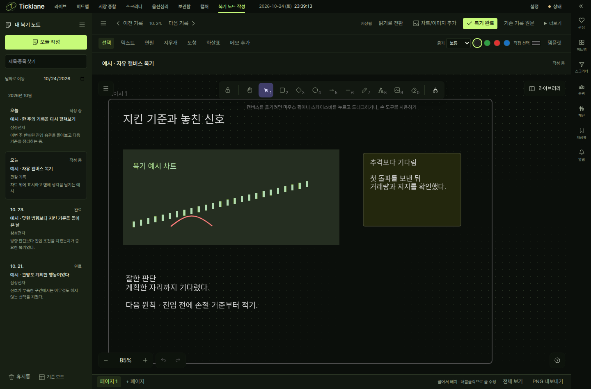

# 날짜별 자유 캔버스 구현·검증

2026-10-24 KST · `codex/review-free-canvas` · 기준 main `4ffb2ae86283d708ed307b2ab9563b4cfa7eae60`.
최종 fetch에서 기준 main이 동일했다. 현재 작업 트리 입력 지문과 실행 환경은 `inputs.json`에 있다.

## 결과

| 검사 | 결과 |
|---|---|
| `cd frontend && npm run typecheck` | 앱·단위·E2E 세 프로젝트 통과 |
| `cd frontend && npx vitest run` | 705 파일 / 9,018 테스트 통과 |
| Playwright review-notes + whiteboard + chart-image-export | 14 시나리오 통과 |
| 마지막 읽기 모드 Delete 보호 후 review-notes 재검증 | 5 시나리오 통과 |
| Vite production build | 위 두 Playwright 실행의 build 통과 |
| Electron whiteboard + full-app | 최종 빌드에서 2 테스트 통과 / sandbox 유지 |
| whiteboards + REST wire contract | 24 테스트 통과 |
| `uv run --extra dev ruff check .` | 위반 0 |
| 영향 경로 ESLint | 오류 0 / 기존 효과 동기화 경고 3 |
| diff 공백·frontend/lockfile 버전 0.0.0 | 통과 |

백엔드 코드는 수정하지 않았다. `hoga/`, `tests/`, Python 의존성·lockfile·설정 입력이
[이전 전체 검증](../2026-10-24-review-notes/README.md)의 지문과 동일함을 확인했다.
백엔드 전체 6,975 통과 결과를 재사용하고, 실제 변경과 연결되는 API·wire 24개는 다시 실행했다.
기존 live-workspace·편집기 청크 크기 경고는 유지한다. 규칙·예외를 추가하지 않았다.

## 실제 검증

- 날짜 정렬·빈 날짜 건너뛰기·이전/다음 끝점, 간단히/자세히 각각 새로고침 후 복원.
- 기존 구조의 모든 글과 원본 이미지를 캔버스에 한 번 펼치고 review 원문은 동일하게 보존.
  삭제한 변환 프레임도 표시로 인식해 원문이 다시 생기지 않는다.
- 실제 포인터로 차트 위 연필 곡선·빨간색·굵기 변경, 선 전용 지우개, 실행 취소·다시 실행.
  지우개가 이미지를 보존함을 API에서 확인한다. 음수 상대 좌표·회전·잠금 판정도 단위 검사한다.
- 이미지와 연필을 같은 페이지에 두어 그림이 이미지 뒤에 가려지는 경로를 막는다.
- 한글 메모 수정·이미지 첨부·자동 저장·페이지 추가·재열기·읽기 모드 Delete 보호·완료.
- PNG 파일 시그니처·편집 파일의 이미지/그림/배치·새 프로필에서 가져온 사본의 객체 ID 보존.
- 503 저장 실패 뒤 IndexedDB 초안 복원, 두 창 충돌 뒤 각 창의 그림을 별도 노트에 보관.
- 실제 라이브 차트 PNG·클립보드 전달과 Code·봉 주기·캡처 시각·종목 복귀 링크 유지.
- 기존 자유 배치 보드의 그룹·복제·잠금·휴지통·PNG·배율/DPR·목록/객체 부하 회귀.
- 1440/944/768px에서 날짜 이동과 그리기 접근성·문서 가로 넘침 없음.
- Electron 종료·동일 프로필 재실행 뒤 메모·이미지·그림·간단히 표시 복원과 네이티브 파일 저장.

## 환경·실행 화면

웹 E2E는 slot 7의 20007/21007, `/tmp/hoga-e2e-review-canvas-final-706d`, 별도 dist,
빈 벤더 자격증명과 workers 1을 사용했다. 사용자 5173/8000 서버·설치 앱을 변경하지 않았다.
마지막 읽기 모드 보호는 기존 14개 시나리오 후의 추가 보완이며, 영향받는 복기 5개와
전체 단위·타입·빌드·Electron을 최종 코드에서 다시 통과했다.

기존 작업용 20806 서버의 소유권·체크아웃·데이터 경로를 확인하고 배포 사본만 갱신했다.
예시 문서는 이 서버에만 추가했다. 실제 production 실행 화면에서도 JS 오류가 없고,
API 요청이 모두 20806으로만 향하는 것을 확인했다. 사용자 서버에는 예시 데이터를 넣지 않았다.
실제 편집기는 Excalidraw 기본 도구·속성 패널을 함께 제공하므로 간소화된 시안과 도구 배치가 다르다.

[Electron 실행 화면](electron.png) · [사용 안내](../../../review-notes.md)
