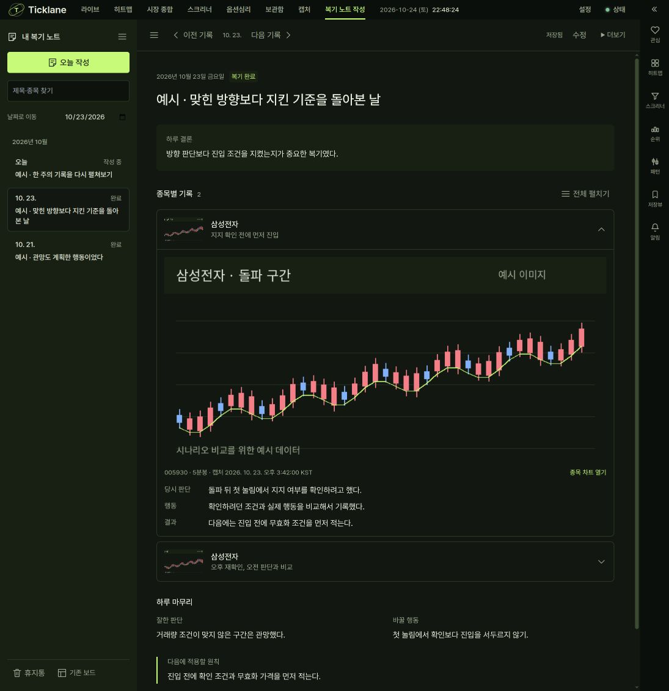

# 날짜별 복기 노트 구현·검증

검증일: 2026-10-24 KST. 브랜치 `codex/daily-review-notes`.
기준 main/HEAD: `ff1488fa3d3471c423169c0422b9bdf29ec541b4`.
최종 fetch에서 main이 동일함을 확인했다. 구현은 이 기준 위의 작업 트리 변경이다.
현재 코드·테스트·의존성·설정 입력의 SHA-256과 실행 환경은 `inputs.json`에 기록한다.

## 결과

| 검사 | 결과 |
|---|---|
| `cd frontend && npm run typecheck` | 앱·단위·E2E 세 프로젝트 통과 |
| `cd frontend && npx vitest run` | 703 파일 / 9,012 테스트 통과 |
| `uv run --extra dev pytest -q -m 'not wallclock'` | 6,975 통과 / 2 skip / 13 deselected |
| `uv run --extra dev ruff check .` | 위반 0 |
| whiteboards + REST wire contract | 최종 변경 경로 24 테스트 통과 |
| 프론트 빌드 | Playwright의 Vite production build 통과 |
| review-notes + whiteboard + chart-image-export E2E | 13 시나리오 통과 / workers 1 |
| Electron whiteboard + full-app E2E | 2 테스트 통과 / workers 1 / sandbox 유지 |
| 최종 diff 공백·frontend 버전 0.0.0 | 통과 |

Python 전체 검증 이후의 Python 변경은 긴 표현식의 줄바꿈뿐이며 동작 변경은 없다.
프론트 lint는 영향 경로에서 오류 0, 외부 조회·URL 전달과 동기화하는 효과 훅 경고 3건이다.
규칙을 끄거나 예외를 추가하지 않았다. 빌드에는 기존 live-workspace와 지연 로드되는
편집기의 청크 크기 경고가 있다. 새 읽기 화면은 편집기를 정적으로 import하지 않는다.

## 실제 검증한 흐름

1. 수정 시각과 독립적인 날짜 정렬, 빈 날짜를 건너뛰는 이전/다음 이동, 양 끝 비활성화.
2. 종목별 개별·전체 펼치기와 접기, 날짜를 왕복한 뒤 펼침·스크롤 위치 복원.
3. 간단히/자세히를 모두 선택하고 각각 새로고침 후 마지막 값 복원. KST 날짜 경계 단위 검사.
4. 빈 날짜 확인 뒤 명시적으로 작성, 한글 제목·결론·판단·행동·결과·다음 원칙 저장.
5. 실제 PNG 첨부·자동 저장·완료·새로고침. 이미지가 포함된 편집 파일을 새 브라우저
   프로필로 가져와 글과 이미지를 함께 복원. 기존 보드에서 복기 목록으로 복귀.
6. 503 저장 실패 중 IndexedDB 초안을 새로고침으로 복원하고 재시도. 두 창의 revision
   충돌에서 원본을 덮지 않고 두 번째 창의 글을 별도 복구 노트에 보관.
7. 오늘 작성의 기존 날짜 재사용, 휴지통 이동·복원 뒤 원문 유지. 서버 동시 요청 8개도
   하나의 같은 날짜 문서를 반환하는 HTTP 검사.
8. 실제 라이브 차트 PNG와 클립보드 이미지를 복기 기록으로 전달하고 Code·주기·시각·
   종목 복귀 링크를 확인. 이미지는 정적인 당시 화면이며 저장 기간 재현을 주장하지 않는다.
9. 기존 자유 배치 보드의 한글 메모·드래그·실행 취소·PNG/편집 파일·복제·휴지통·
   잠금·배율·부하 시나리오 회귀. 좁은 944/768px 화면에서 앱 메뉴와 노트 이동 유지.
10. Electron 네이티브 파일 내보내기와 실제 앱 종료·같은 프로필 재실행 후 글·이미지·
    간단히 표시 옵션 복원. 기존 설정 가져오기/내보내기와 새 작업 창도 유지.

검증 중 기존 보드의 자동 첫 항목 선택이 가져오기·복기 화면 복귀와 경합하는 경로,
이전 문서의 입력창이 다음 문서 로딩 중 남는 경로를 보완했다. 현재 URL의 문서 ID와
일치하는 세션만 편집에 노출하고, 작업 중에는 자동 선택을 멈춘다. 복제 후 검사는
새 문서 이름이 표시된 것을 확인한 뒤 편집하며, 휴지통 선택은 고유 문서 ID를 쓴다.

반복 실행에서 이전 부하 테스트의 보드가 1,000개 이상 누적되어 기존 단일 실행 부하
범위를 벗어난 결과가 있었다. 소유권·미점유 포트를 확인하고 이 워크트리의
`/tmp/hoga-e2e-data-7`만 초기화한 뒤 13 시나리오 전체를 다시 통과했다. 사용자 데이터나
다른 서버를 정리하지 않았다. 이 검증이 수천 개 보드의 최적화를 보장하지는 않는다.

## 환경과 실행 화면

- 브라우저는 시스템 Chrome, Electron은 44.8.0, Node v24.13.1, Python 3.14.7.
- E2E는 slot 7의 20007/21007, `/tmp/hoga-e2e-data-7`, 별도 dist, 무자격 단일 워커다.
- 사용자 5173/8000 서버·설치 앱·바로가기·샌드박스 설정은 변경하지 않았다.
- 작업용 20806 서버와 `/tmp/hoga-whiteboard-review-706d`에는 명시된 예시 노트만 추가했다.
  원래 자유 배치 예시 보드는 보존했다. 설치 앱 배포나 main 머지는 이 작업에 포함하지 않는다.
- 실제 in-app browser에서도 간단히 선택 → 새로고침 유지, 이전·다음 날짜, Escape로
  옵션 닫기를 확인했다. 시안이 아닌 실행 중인 production build 화면이다.

[목록 표시 선택](display-options.png) · [Electron 실행 화면](review-electron.png)

사용 방법·보존 정책은 [복기 노트 안내](../../../review-notes.md), 기존 자유 배치는
[화이트보드 안내](../../../whiteboard.md)에 있다.
