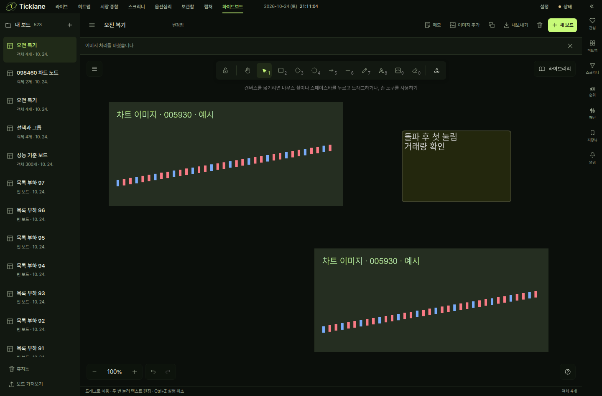

# 화이트보드 구현·검증 기록

검증일: 2026-10-24 KST. 작업 브랜치: `codex/whiteboard`.
기준 main/HEAD: `3730bf91f211751a3b60b15cec1c227a33fd10f0`.
최종 fetch에서 main과의 차이는 0/0이었다. 구현은 이 기준 위의 작업 트리 변경이다.
변경 파일별 SHA-256과 도구 버전은 [inputs.json](inputs.json)에 기록한다.

## 구현 결과

- 상단 캡처 옆 `/whiteboard`, 좌측 보드 목록, 헤더, 점 격자 캔버스, 공통 우측 레일.
- 실제 Excalidraw 0.18.1 편집기, 앱 테마·한국어 UI, 한글 메모·텍스트·도형·화살표·펜.
- 다중 선택·그룹·복제·잠금·크기 조절·순서·실행 취소/다시 실행.
- PNG/JPEG/WebP 파일·드롭·클립보드, 이미지 포함 편집 파일 왕복과 PNG 내보내기.
- 서버 원자적 문서 저장, 별도 불변 이미지, revision 충돌 방지, 재시도 식별자.
- 창별 IndexedDB 초안, 새로고침/재실행 복구, 저장 응답과 최신 변경의 세대 구분.
- 보드 복제·휴지통 복원, 충돌 시 내 편집을 별도 보드에 보관하고 최신본 열기.
- 실제 차트 PNG를 목적 보드로 보내고 Code·봉 주기·시각·종목 복귀 링크를 보관.

시안의 앱 셸과 보드 목록 배치를 적용했다. 캔버스 안에서는 편집기 기본 도구 모음과
선택 시 속성 패널을 유지한다. 사설 편집기 API나 내부 UI 대량 숨김을 사용하지 않는다.
메모 모서리는 6px이며, 문서의 객체 스타일은 사용자가 계속 변경할 수 있다.

## 검증 결과

| 검사 | 명령/범위 | 결과 |
|---|---|---|
| 프론트 타입 | `cd frontend && npm run typecheck` | 앱·단위·E2E 세 프로젝트 통과 |
| 전체 프론트 단위 | `cd frontend && npx vitest run` | 702 파일, 9,008 테스트 통과 |
| 영향 경로 단위 | session·ChartCaptureActions·TopNav | 23 테스트 통과 |
| 전체 백엔드 | `uv run pytest -q -m 'not wallclock'` | 6,971 통과, 2 skip, 13 deselected |
| 신규 저장/HTTP/wire | whiteboards + REST wire contract | 20 테스트 통과 |
| Python lint | `uv run ruff check .` | 위반 0 |
| 프론트 빌드 | `cd frontend && npx vite build` | 통과, 폰트/자산 자체 제공 |
| 브라우저 핵심 | whiteboard.spec.ts + chart-image-export.spec.ts | 8 시나리오 통과 |
| 브라우저 한글 IME | `Input.imeSetComposition` → `Input.insertText` → 서버 저장/재열기 | 통과 |
| 배율 좌표 | 125%/150% 상당의 유효 뷰포트·DPR에서 실제 포인터 그리기와 픽셀 크기 | 5회 반복 통과 |
| Electron | full-app.spec.cjs + whiteboard.spec.cjs | 2 시나리오 통과 |
| 기타 | diff whitespace·frontend 버전 0.0.0 정합성 | 통과 |

프론트 lint는 새 파일/변경 경로에서 오류 0, URL과 서버 조회를 동기화하는
효과 훅에 대한 `set-state-in-effect` 경고 2건이다. 규칙을 끄거나 예외를 추가하지 않았다.
빌드에는 기존 live-workspace 및 lazy 편집기 청크의 크기 경고가 있다. 임계값을
늘려 숨기지 않았다. 편집기 청크는 화이트보드 진입 시 로드한다.

브라우저는 시스템 Google Chrome 156.0.8078.47, Electron은 44.8.0,
Node v24.13.1, Python 3.14.7이다. 테스트 서버는 단일 워커·무자격·별도 데이터로
실행했다. 기본 E2E 자원은 slot 7의 20007/21007 포트 및 `/tmp/hoga-e2e-data-7`이다.
사용자 5173/8000 서버나 설치 바로가기·샌드박스 설정은 변경하지 않았다.

## 실제로 확인한 시나리오

1. 한글 이름과 실제 IME 조합 입력, 두 줄 메모 편집, 드래그 후 실행 취소, 재열기.
2. 이미지 자동 저장·서버 재조회, PNG 생성, 이미지 포함 편집 파일을 새 브라우저
   프로필로 가져와 새 보드로 복원.
3. 두 창의 revision 충돌, 두 번째 창의 편집 유지와 새 보드로 보관.
4. 저장 503 장애 중 편집, 새로고침 후 IndexedDB 초안 복구, 재시도와 서버 확정 저장.
5. 복제 보드의 이름/내용 독립성, 휴지통 이동과 복원.
6. 실제 라이브 차트 PNG 생성·클립보드 복사·목적 보드 추가·보드에서 다시 붙여넣기.
7. 그룹·복제·잠금·실행 취소, 잠긴 객체의 Delete 보호, 1024/944/768px과 light 테마.
8. 300개 객체·20개 이미지·100개 이상 보드에서 팬과 반복 보드 전환.
9. Electron 네이티브 다운로드, 프로세스 종료 후 같은 사용자 프로필로 재실행하여
   서버의 이미지·메모 복원. 앱 종료 후 서버가 계속 동작함도 확인.

반복 검사에서 Excalidraw의 기본 Delete 동작이 선택된 잠긴 객체를 삭제하는 것을
발견했다. 앱의 키보드 입력 경계에서 잠긴 객체를 보존하고 잠기지 않은 선택만
삭제하도록 수정했다. 테스트는 빈 배열의 `every()`가 성공하는 함정을 피하고,
네 개의 잠긴 객체가 서버에 남는지 저장 응답 후 확인한다. 수정 후 5회 반복 통과했다.

OS 한국어 입력기의 후보창/키보드 전환 자체는 자동화하지 않았다. Chromium의 실제
IME 조합·확정 이벤트 경로와 편집기·서버 저장을 검증했다. 배율은 별도 DPR/유효
뷰포트 검사로 확인하며 OS의 브라우저 확대 메뉴 조작과 구분한다.

배율 검사는 1440×950 물리 크기에 대응하는 CSS 뷰포트와 DPR 1.25/1.5를 설정하고,
캔버스 비트맵 크기와 실제 드래그로 만든 사각형의 장면 좌표 폭을 확인했다.
기본 도구의 투명 radio input을 직접 누르는 테스트 선택자를 실제 캔버스 포커스와
공개 단축키 R로 바꾼 뒤 5회 반복 통과했다. 제품의 입력 동작 변경은 필요하지 않았다.

## 부하 측정

[performance.json](performance.json)은 최종 브라우저 실행에서 추출했다.

- 객체 300개, 서로 다른 이미지 20장, 각 이미지 1600×1000px, 보드 100개 이상.
- 팬 중 rAF 프레임 간격 p95 약 16.8ms.
- 포인터 이벤트에서 다음 rAF까지 p95 약 0.5ms. 실제 디스플레이까지의 지연 측정은 아니다.
- 5회 왕복 보드 전환 및 명시적 GC 후 JS heap 약 41.0MB → 43.3MB.
  GPU/이미지 디코더의 외부 메모리를 포함하는 수치는 아니다.
- frame p95 <34ms, 포인터→rAF p95 <100ms, JS heap 증가 한도 검사를 통과했다.

특정 테스트 환경의 실측이며 모든 하드웨어/최대 24MP 원본 20장에 대한 보장은 아니다.
이미지 원본은 축소 저장하지 않고 표시 크기만 조절한다.

## 실행 화면과 사용 방법

[Electron 실행 화면](whiteboard-electron.png) · [사용 방법과 복구 안내](../../../whiteboard.md)

화면의 차트는 검증용 예시 이미지다. 테스트 자료는 별도 임시 데이터에만 저장했다.
사용자 서버에 보드나 예시 자료를 주입하거나 설치 앱에 배포한 기록이 아니다.
보드 파일/이미지 보존 정책, 내보내기 한도와 복구 경계는 사용 문서에 명시했다.
