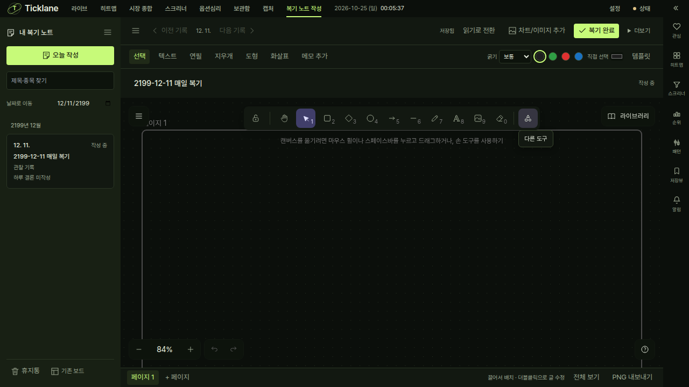
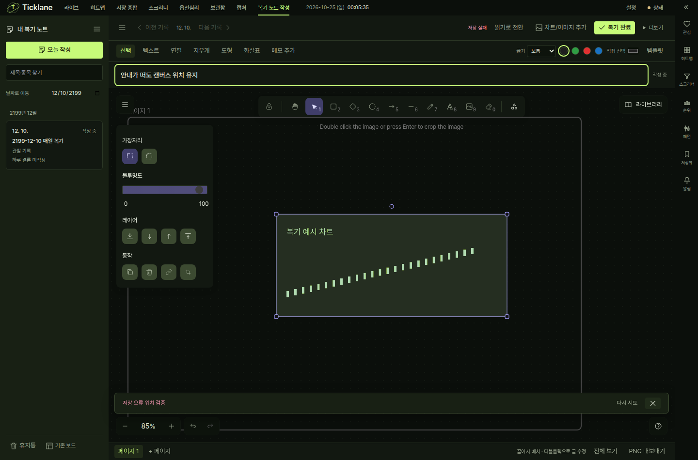

# 복기 캔버스 안내·외부 링크·공통 툴팁 수정

2026-10-25 KST · `codex/review-canvas-notices` · 기준 main `ba2d66816`.
최신 main을 반영한 뒤 최종 검사했다. 실행 입력과 환경은 `inputs.json`, 결과·명령은
`results.json`에 기록한다. 이번 작업에서 백엔드·의존성·검증 임계값은 변경하지 않았다.

## 원인과 수정

- Excalidraw 0.18.1의 `validateEmbeddable={false}`는 렌더링을 막지만 웹 임베드 도구를
  숨기지 않았다. 해당 객체가 저장 요청에 남아 `whiteboard_embed_disabled` 422를 발생시켰다.
  지원하지 않는 도구만 숨기고 프레임·Mermaid는 유지했다. 기존 초안은 주소가 든 링크
  메모로 복구한다. ID·원래 주소·위치·프레임·그룹·잠금·삭제 상태·기존 객체 연결을 유지한다.
  외부 페이지를 자동 실행하거나 접속하지 않는다.
- 서버가 적용하지 않았다고 확정한 위 422 요청은 버리고 수정된 장면을 새 mutation으로
  저장한다. 요청 중 복구한 경우도 처리한다. 적용 여부가 모호한 네트워크 오류는 기존
  idempotent 재시도와 초안을 유지한다.
- 안내·오류·충돌 패널이 flex 본문 높이를 차지해 캔버스를 밀었다. 기존 복기와 기존 보드
  양쪽의 패널을 하단 겹침 표시로 변경했다. 표시·닫기·재시도에서 캔버스 위치·높이가 유지된다.
- 캔버스의 native title과 자체 호버 안내를 공통 `useTextTooltip`에 연결했다. 선 색상은
  `TooltipButton`을 사용한다. 기존 공통 표면·지연·화면 경계 보정·닫기를 그대로 사용하며
  도구명·단축키·색상 의미를 유지한다. 독자적인 툴팁 스타일은 추가하지 않았다.

## 검증

| 검사 | 최종 결과 |
|---|---|
| 프론트 타입 | 앱·단위·E2E 프로젝트 통과 |
| 프론트 전체 단위 | 706 파일 / 9,029 통과 |
| 관련 브라우저 E2E | 17 시나리오 통과 |
| Electron | 2 통과 / sandbox 유지 |
| 프로덕션 빌드 | 통과 / 기존 청크 크기 경고 유지 |
| 변경 경로 ESLint | 오류·경고 0 |
| diff·프론트 버전 | 통과 / 0.0.0 유지 |

브라우저에서는 IndexedDB에 실제 실패 초안을 넣어 활성 임베드와 삭제된 iframe을 함께
복구했다. 주소 텍스트·삭제 상태·저장 완료와 외부 요청 없음, 웹 임베드 숨김·Mermaid 유지,
이미지 성공 안내·503 오류·재시도마다 캔버스 y/height 변화 합계 1px 미만을 검사했다.
공통 툴팁의 기본 도구·추가 도구·선 색상·키보드 접근·Esc/클릭/스크롤 닫기, 중복 없음,
다른 공통 툴팁과의 계산된 글꼴·크기·배경·모서리·여백 일치도 실제 브라우저에서 검사했다.
기존 날짜 이동·표시 옵션 저장·연필·지우개·실행 취소·이미지·그룹·잠금·장애·충돌·파일
왕복·차트 PNG도 회귀 검사했다.

초기 동시 검사 실행에서 부하 보드 프레임 p95가 50ms로 기준 34ms를 초과했다. 최종
단독 브라우저 실행은 같은 기준·데이터 규모에서 16.8ms, 포인터→프레임 p95 0.3ms로
통과했다. 테스트·시간 제한을 완화하지 않았다.

백엔드 전체는 main에 기록된 스크리너 통합 검증의 7,122 통과 결과를 재사용한다.
관련 백엔드·테스트·의존성·설정 839파일이 현재 체크아웃과 동일함을 비교했다
(`backend-reuse.json`). API를 바꾸지 않았으며 실제 브라우저와 Electron의 저장 경로도
현재 main의 격리 서버에서 검사했다.

## 실행 화면

작업용 20806 서버의 체크아웃·데이터·dist 소유권을 확인한 뒤 배포 사본만 갱신했다.
기존 해시 자산을 유지하고 index를 마지막에 반영했다. 서버 재시작·사용자 5173/8000
서버 조작·사용자 초안 삭제는 하지 않았다. 미리보기도 JS 오류 없이 열리고 API가 모두
20806으로 향함을 확인했다. 현재 열려 있는 페이지는 새로고침하면 반영된다.

