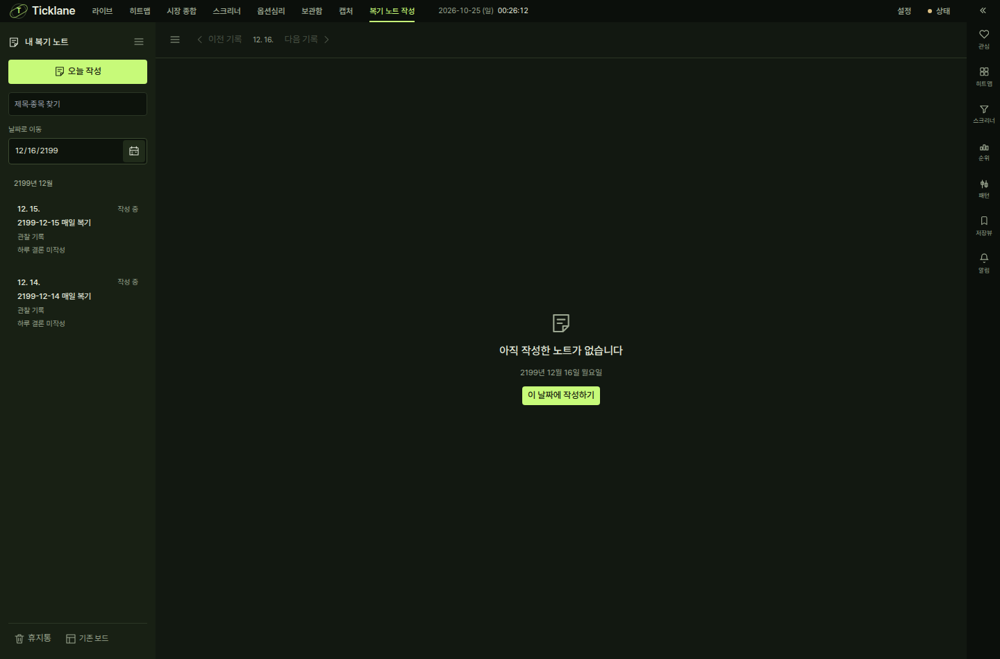
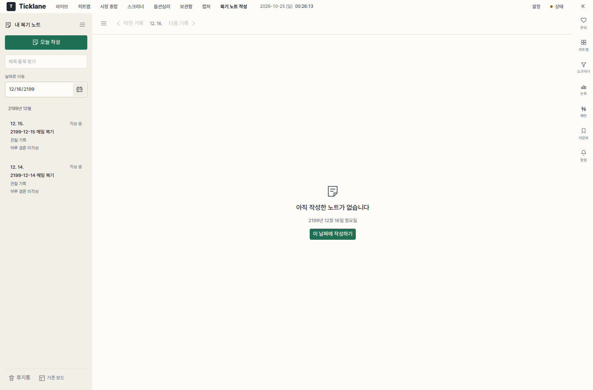

# 복기 노트 달력 아이콘 정리

2026-10-25 KST · `codex/review-calendar-control` · 기준 main `acc8394b8`.
검사 입력·환경·소스 그룹 지문은 `inputs.json`에 기록한다.

기본 브라우저의 작고 어두운 달력 아이콘을 공통 BoardIcon SVG 16px와 32px 버튼으로
대체했다. 날짜 입력과 한 필드로 정렬하고 공통 표면·테두리·포커스·툴팁을 사용한다.
브라우저 날짜 선택기의 color-scheme도 현재 테마 토큰을 따른다. 직접 입력을 유지하며
선택기를 제공하지 않는 내장 브라우저에서는 날짜 입력 포커스를 유지한다.

## 검사

- `cd frontend && npm run typecheck`: 앱·단위·E2E 프로젝트 통과.
- `cd frontend && npx vitest run src/whiteboard src/ui`: 25파일 / 115개 통과.
- `cd frontend && npx playwright test tests/e2e/review-notes.spec.ts --grep '날짜 목록|달력 아이콘' --reporter=line`:
  2 시나리오 통과. 격리 데이터·dist, 빈 자격증명, workers 1을 사용했다. production build도 통과했다.
- 버튼 호버의 공통 툴팁, SVG 크기와 클릭 영역, **실제 native 달력 열기→오른쪽 화살표→Enter로
  다음 날 기록 이동**, 직접 입력으로 기존 기록·빈 날짜 이동을 검사했다.
- trading-desk/ledger의 날짜 입력 color-scheme·SVG 글자색 일치와 실제 화면을 확인했다.
  기존 날짜 목록·이전/다음·간단히/자세히 저장과 1440/944/768px 레이아웃 검사를 함께 통과했다.
- 영향 TS/TSX ESLint는 오류 0, 기존 ReviewNotes 효과 동기화 경고 3건이다. 규칙·예외를 추가하지 않았다.
- `git diff --check` 통과. 백엔드·의존성·API는 변경하지 않았다.

작업용 20806 미리보기의 소유권을 확인하고 배포 사본만 갱신했다. 예전 자산을 유지하고
index를 마지막에 반영했다. 실제 페이지에서 새 달력 SVG 버튼 표시·JS 오류 없음·API가
20806으로만 향함을 확인했다. 사용자 5173/8000 서버와 기본 체크아웃의 로컬 수정을
변경하지 않았다. 현재 페이지는 새로고침하면 반영된다.

